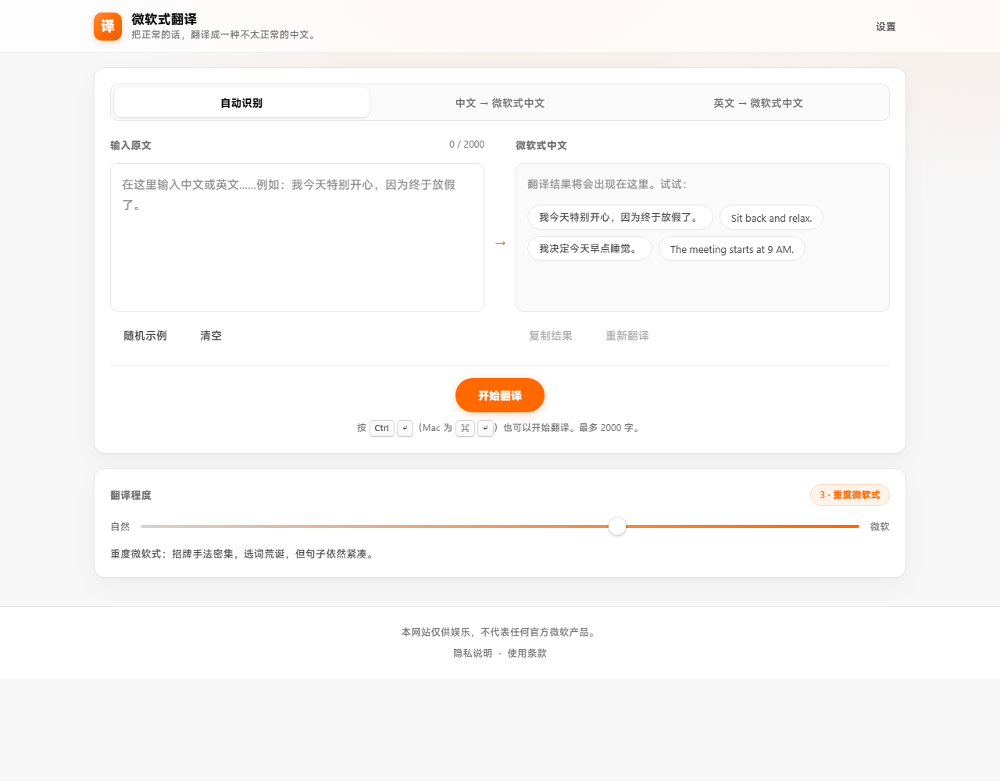
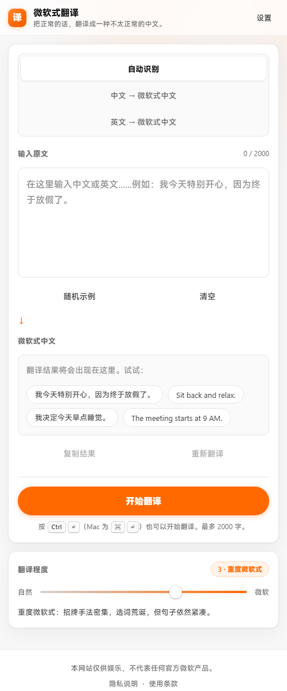

# 微软式翻译

> 把正常的话，翻译成一种不太正常的中文。

**在线体验：<https://xiiiii422.github.io/msstyle-translate/>**





一个纯娱乐性质的静态网页小玩具：输入一句正常的中文或英文，AI 把它改写成**一本正经、生硬、直译、语序奇怪但依然看得懂**的"微软式中文"。

纯静态 HTML + CSS + JavaScript，**没有后端、没有数据库、没有构建步骤**，下载即可运行，可直接部署到 GitHub Pages / Cloudflare Pages / 阿里云 OSS 等任意静态托管服务。

---

## 1. 项目文件结构

```
微软式翻译/
│
├── ── 部署时需要的文件 ──────────────────────────────
├── index.html           # 页面结构
├── style.css            # 全部样式与响应式适配
├── prompt.js            # ★ 提示词唯一来源（前端 + 两份代理共用）
├── script.js            # 配置 + API 封装 + 存储 + UI
├── secret.js            # ★ 内置 Key 的密文容器（由 make-secret.js 生成）
├── config.js            # 可选：部署者用它预置 Key / 模型 / 代理地址（默认留空）
├── manifest.webmanifest # PWA 清单
├── icon.svg             # 站点图标（矢量源）
├── icon-180.png         # iOS 主屏图标（iOS 不认 SVG）
├── icon-192.png         # PWA 图标
├── icon-512.png         # PWA 大图标
├── og-image.png         # 社交分享图（1200×630，已生成好）
├── og-image.svg         # 分享图的源文件（改图时用）
├── privacy.html         # 隐私说明（合规必需）
├── terms.html           # 使用条款（合规必需）
├── _headers             # 安全响应头（Cloudflare Pages / Netlify 自动读取）
├── README.md            # 本文件
│
├── ── 商用部署（可选，见第 5 节）──────────────────
└── proxy/
    ├── cloudflare-worker.js  # Cloudflare Worker 代理（推荐，免费额度够用）
    ├── node-server.js        # Node/Express 代理（自建服务器用）
    └── smoke-test.js         # 部署后冒烟自检（25 项，可接 CI）
│
└── ── 开发期测试脚本，部署时可以不传 ────────────────
    ├── test-ui.js              # jsdom：交互/状态机/降级/错误处理（79 项）
    ├── test-secret.js          # ★ 内置 Key 密文：能解开、无明文、防篡改（18 项）
    ├── test-level-ladder.js    # ★ 档位阶梯结构：每档只多一个可数标记（50 项）
    ├── test-draft.js           # ★ 输入草稿/防抖/手机端结果揭示（23 项）
    ├── test-vault-wiring.js    # ★ 内置 Key 接线：页面真的用上了它（22 项）
    ├── test-settings.js        # Key 设置、引导、竞态、存储降级（27 项）
    ├── test-scrub.js           # 文言文清洗单元测试（15 项）
    ├── test-proxy.js           # 代理：限流/CORS/校验/Key 安全/可观测性（63 项）
    ├── test-proxy-client.js    # 前端代理模式：探测/回退/UI 适配（21 项）
    ├── test-concurrency.js     # 并发/负载：串数据、指标准确性、限流（22 项）
    ├── test-redis-ratelimit.js # Redis 限流：跨实例共享、故障语义（21 项）
    ├── test-worker.js          # Cloudflare Worker 功能测试（56 项）
    ├── test-entrypoints.js     # ★ 部署入口冒烟：真执行每条路径（19 项）
    ├── test-pageload.js        # ★ 页面加载：<script src> 顺序、无 JS 降级（35 项）
    ├── test-deploy-http.js     # ★ 真实 HTTP + 真实响应头部署验证（17 项）
    ├── test-deadline-cancel.js # ★ 最坏等待时间 + 取消功能（23 项）
    ├── test-feature-truth.js   # ★ 功能宣称 vs 实际行为审计（36 项）
    ├── test-doc-claims.js      # ★ 文档宣称 vs 代码实际（31 项）
    ├── test-manual-checklist.js # ★ README 手动清单 vs 实际行为（29 项）
    ├── test-css-audit.js       # ★ CSS 真实生效性：死样式/触摸目标/断点（22 项）
    ├── test-browser-layout.js  # ★ 假布局下的真实行为：autoGrow/视口变化（19 项）
    ├── test-mobile-scenarios.js # ★ 手机专属场景：安全区域/缩放/剪贴板（19 项）
    ├── test-long-session.js     # ★ 长会话/内存：监听器、DOM、定时器、存储（17 项）
    ├── test-history-ux.js      # ★ 历史记录体验：渐进显示/单条复制（15 项）
    ├── test-history-drawer.js  # ★ 移动端历史抽屉：开关/Esc/遮罩（12 项）
    ├── test-esc-scroll.js      # ★ ESC 全局关闭 + 滚动锁定（7 项）
    ├── test-incomplete-deploy.js # ★ 缺文件时的降级：是否给出可见提示（9 项）
    ├── test-misconfig.js       # ★ 代理配置错误：Redis/端口/依赖缺失（13 项）
    ├── test-integrity-guard.js  # ★ 验证"被强杀后的自动还原"有效（2 项）
    ├── test-level-monotonic.js # ★ 联网：档位区分度（机器味须随档位递增）
    ├── test-mutation.js        # ★ 变异测试：确认这些测试真的能发现破坏（61 项）
    ├── test-style.js           # 联网：检查输出风格是否跑偏成文言文
    ├── test-e2e.js             # 联网：走完整"输入→翻译→结果"流程
    ├── test-proxy-e2e.js       # 联网：经由真实代理的端到端
    ├── test-worker-live.js     # 联网：经由 Worker 的真实翻译
    ├── test-prompt-parity-live.js # 联网：直连与代理输出质量对比
    ├── check-prompt-parity.js  # 提示词唯一来源校验（29 项）
    ├── check-assets.js         # 资源完整性 + CSP 与代理地址一致性
    ├── check-csp.js            # CSP 与页面实际需求是否匹配（23 项）
    ├── check-contrast.js       # 实测所有配色的 WCAG 对比度（28 项判定）
    ├── check-claim-counts.js   # ★ 核对 README 里声明的条数与实际是否一致
    ├── check-comment-claims.js # ★ 核对代码注释里的技术声称是否属实（22 项）
    ├── test-comment-behavior.js # ★ 行为级核对：注释声称的行为真的发生吗（11 项）
    ├── test-claim-counts.js    # ★ 验证上面这个核对器真的能发现过期数字
    ├── make-og.js              # 由 og-image.svg 生成 og-image.png
    ├── make-icons.js           # 由 icon.svg 生成 icon-180/192/512.png
    ├── make-secret.js          # 由真实 Key 生成加密的 secret.js
    └── detect.js               # 文言文检测器，供联网测试使用
```

### 部署文件分三档

| 档位 | 文件 | 缺失后果 |
| --- | --- | --- |
| **必需** | `index.html`、`style.css`、`script.js`、**`prompt.js`** | 缺任何一个，翻译功能都不可用 |
| 推荐 | `config.js`、`secret.js`、`manifest.webmanifest`、`icon.svg`、`icon-180.png`、`icon-192.png`、`icon-512.png`、`og-image.png`、`privacy.html`、`terms.html` | 少了内置 Key / 图标 / 分享图 / 合规页 |
| 可选 | `_headers` | 少了安全响应头（需自行在托管层配置） |

> ⚠️ **`prompt.js` 是必需的**，别漏了。
> 提示词从第 4 轮起统一放在 `prompt.js`（前端与两份代理共用同一份），
> `script.js` 依赖它。漏传的话页面看起来正常，但点「开始翻译」不会有任何结果 ——
> 早期版本的 README 曾把最小集写成 3 个文件，这是错的，已修正。
>
> 现在即使漏传，页面顶部也会显示一条醒目提示说明原因，
> 而不是静默失效（见 `test-incomplete-deploy.js`）。

网页本身零依赖、无构建步骤。


---

## 2. API Key 放在哪里

有 **4 种方式**，优先级从高到低。普通访客完全不需要改源码。

### 方式零（本站默认）：内置加密 Key

仓库里的 `secret.js` 内置了一个**加密过的** Key，访客打开页面就能直接翻译，什么都不用填。

它不是明文：真实 Key 以 AES-256-GCM 密文形式存放，页面加载后用 WebCrypto
从被打散的口令里派生出密钥再解开。生成与更换方式见第 2.5 节。

优先级最低 —— 访客自己填了 Key、或 `config.js` 里预置了 Key，都会覆盖它。

### 方式一（推荐，自建部署）：访客自己在页面上填

打开页面 → 右上角「**设置**」→ 粘贴自己的智谱 API Key → 保存。

- Key 只存在**访客自己浏览器**的 localStorage 里，不会上传到你的服务器
- 没有任何 Key 时，页面会自动弹出引导，教用户去哪里申请
- 未配置时「设置」按钮上会有个红点提示

这是公共部署的推荐方式：每个访客用自己的额度，你不用担心被刷。

### 方式二：部署者用 `config.js` 预置

新建 `config.js`（仓库里已有一个留空的模板）：

```js
window.__MSSTYLE_CONFIG__ = {
  apiKey: "你的智谱 API Key",
  model: "glm-4-flash-250414",
  fallbackModels: ["glm-4-flash"]
};
```

⚠️ **这样所有访客都能在源码里看到这个 Key**，只适合个人测试。
建议把 `config.js` 加进 `.gitignore`，用 CI/部署平台的环境变量生成它。

### 方式三：直接改 `script.js` 的常量

```js
const API_KEY = "YOUR_API_KEY";   // ← 替换掉
```

同样会被所有访客看到。**这是优先级最低的一种**：如果访客在页面上填了自己的 Key，
会覆盖这里预置的值。

### 2.5 内置 Key 的加密机制与安全边界

#### 它是怎么打包的

`secret.js` 里**没有任何明文 Key**，只有几组纯数字：

| 组成 | 处理方式 |
| --- | --- |
| 真实 Key | AES-256-GCM 加密 → 密文 + 16 字节认证标签 |
| 加密口令 | 44 位随机口令，按字节异或 + 偏移后打散成数字数组 |
| 派生方式 | PBKDF2-HMAC-SHA256，15 万轮，随机 16 字节盐 |
| 存储布局 | 密文 / 标签 / IV / 盐 / 口令**交错**塞进一个数组，前面插 37 个诱饵数字 |
| 域名锁 | 只在 `localhost`、`127.0.0.1`、`*.github.io`、`*.pages.dev` 等白名单域名下解密 |

篡改任意一个字节（除了诱饵）都会让 GCM 认证失败，解出来是 `null` ——
`test-secret.js` 里专门验证了这一点。

#### 换 Key 怎么做

```powershell
# Key 只从环境变量读，不进版本库、不落盘
$env:ZHIPU_KEY="你的新 Key"
node make-secret.js secret.js
```

`make-secret.js` 会重新生成 `secret.js`，控制台只提示"已写入 xxx（无明文 Key）"。

#### 必须理解的边界

> **纯前端不存在真正的密钥保护。**
> 浏览器最终必须把明文还原出来才能带着它去请求接口 ——
> 在 `fetch` 上打一个断点，或者在解密函数返回处停一下，谁都能拿到。
> 任何所谓"前端加密"都只是提高门槛，不是安全边界。

这层混淆实际能挡住的是：

| 威胁 | 是否挡住 |
| --- | --- |
| 随手「查看网页源代码」找 Key | 挡住 |
| GitHub Secret Scanning / 各种密钥爬虫 | 挡住（没有可匹配的明文） |
| 把页面 copy 到自己的域名下白嫖 | 挡住（域名锁，解不开） |
| `secret.js` 被改动/替换 | 挡住（GCM 认证失败） |
| **专门逆向的人打断点抓请求头** | **挡不住** |

要真正保密只有一条路：把 Key 放到服务端代理（第 5 节），让浏览器永远拿不到它。

### 配置项一览

| 配置项 | 默认值 | 说明 |
| --- | --- | --- |
| `API_URL` | `https://open.bigmodel.cn/api/paas/v4/chat/completions` | 智谱开放平台通用接口 |
| `MODEL` | `glm-4-flash-250414` | 首选模型（实测最稳、最快、机器味最足，见下方说明） |
| `FALLBACK_MODELS` | `["glm-4-flash", "glm-4.7-flash"]` | 备用模型，见下方说明 |
| `TEMPERATURE` | `1.0` | 兜底采样温度（档位不在 `LEVEL_TEMPERATURE` 里时用它） |
| `LEVEL_TEMPERATURE` | `{1:0.55, 2:0.75, 3:0.95, 4:1.0}` | **分档温度**（表在 `prompt.js`，前端与两份代理共用）。⚠️ 上限必须是 `1.0`，见下 |
| `MAX_TOKENS` | `2048` | 单次最大输出长度（见下方"思考模式"说明） |
| `THINKING_DISABLED` | `true` | 关闭思考模式，**强烈建议保持开启** |
| `TIMEOUT` | `60000` | 单个模型的超时（毫秒） |
| `TOTAL_TIMEOUT` | `25000` | 一次翻译所有尝试加起来的总预算（毫秒，**硬上限**） |
| `MAX_INPUT` | `2000` | 最大输入字符数 |
| `HISTORY_LIMIT` | `10` | localStorage 中保留的历史记录条数 |

### ⚠️ 温度的合法区间是 [0, 1]，越界会整档失效

`LEVEL_TEMPERATURE` 里第 4 档曾经写成 `1.1`，看着只是"再放开一点"，
实际后果是：**第 4 档每一次翻译都失败**。

原因是一条错误链，三段各自都"合理"：

1. 智谱接口对越界的 temperature 直接返回 `400 / code 1210「temperature参数非法」`；
2. 前端的降级重试只认"限流 / 过载 / 超时 / 空内容"，**400 不在白名单里**（因为换模型确实救不了参数错误）；
3. 于是错误一路走到友好提示，用户只看到"翻译系统出现了一点非常机器的问题"，
   完全猜不到是滑块惹的。

现在 `prompt.js` 的 `clampTemperature()` 会把温度夹回 `[0,1]`，
配置写错也只会退化成"这一档没那么夸张"，而不是整档报废；
`test-level-ladder.js` 里也有断言钉住"四档温度都必须 ∈ [0,1]"。

### ⚠️ 最重要的一个坑：思考模式导致"翻译失败"

**这是本项目最难排查的一个 bug，换任何模型前请先读这段。**

`glm-4.7-flash` 是一个**思考模型**：它会先生成一大段
`message.reasoning_content`（内部推理），然后才输出正文 `message.content`。

实测数据（同一个请求）：

| 配置 | reasoning tokens | 结果 | 耗时 |
| --- | --- | --- | --- |
| 默认（思考开启）+ `max_tokens: 1024` | 828 ~ 1018 | **content 为空**，`finish_reason: "length"` | ~9700ms |
| 思考开启 + `max_tokens: 2048` | ~1000 | 正常 | ~8000ms |
| **思考关闭** | 0 | 正常 | **~470ms** |

也就是说：**接口返回 HTTP 200，但 `content` 是空字符串**，
推理过程把 token 额度吃光了。前端只会看到"内容为空"，
用户看到的是"翻译系统暂时出现了一点非常机器的问题"。

代码里的两道防线：

```js
MAX_TOKENS: 2048,          // 1. 额度给够
THINKING_DISABLED: true,   // 2. 直接关掉思考（关键）
```

关掉之后：**响应从 ~9700ms 降到 ~470ms（快 20 倍），而且输出正常。**

这个任务只是"换一种说法"，完全不需要推理，所以关闭是纯收益。
如果你换成不支持该参数的模型，服务端会忽略 `thinking` 字段，不影响兼容性。

### 关于备用模型

实测 `glm-4.7-flash` 在高峰期会返回 `429 / code 1305`（该模型当前访问量过大），
因此代码实现了**自动降级**：

1. 先请求 `MODEL`
2. 如果是"过载 / 限流 / 超时 / 网络抖动 / 内容为空"，自动改用 `FALLBACK_MODELS[0]`
3. 还不行就再试 `FALLBACK_MODELS[1]`
4. Key 错误、余额不足这类"换模型也没用"的问题**不会**浪费次数重试，直接给提示

**为什么首选不是更新的 `glm-4.7-flash`：** 每次请求都要先等它失败（约 400ms）
才降级，用户白等一趟还不说，多一次往返就多一次出错机会。实测
`glm-4-flash-250414` 约 500ms 返回、几乎不失败，所以把这个位置让给最好用的那个，
而不是最新的那个。`glm-4.7-flash` 仍在备用链里，高峰期过去它照样能顶上。


```js
MODEL: "glm-4-flash-250414",   // 稳定性优先
```

不想要自动降级就把 `FALLBACK_MODELS` 改成 `[]`。

### 获取 API Key

1. 访问智谱开放平台 <https://bigmodel.cn>
2. 注册并登录
3. 打开 [API Keys 管理页](https://bigmodel.cn/usercenter/proj-mgmt/apikeys) 创建一个 Key
4. 回到页面，点右上角「设置」粘贴进去即可（不需要改任何源码）

---

## 3. 运行方法

### 方式一：直接双击（最快）

直接双击 `index.html`，用 Chrome / Edge / Safari 打开即可。

因为 `script.js` 是普通脚本（不是 ES module），所以 `file://` 协议下也能正常工作。

### 方式二：本地静态服务器（推荐）

部分浏览器在 `file://` 下对剪贴板 API 有限制，用本地服务器体验更完整：

```bash
# 任选一种，在项目目录下执行
python -m http.server 8080

# 或
npx serve .
```

然后浏览器打开 <http://localhost:8080>。

> 提示：`localhost` 属于安全上下文，`navigator.clipboard` 可正常使用；如果是 `http://` 的局域网 IP 访问，代码会自动降级到 `document.execCommand('copy')` 兼容方案。

---

## 4. 静态部署方法

本项目没有任何构建步骤，**把文件原样上传即可**。

### ⚠️ 换域名时要改的两处

仓库当前已经把地址填成 **GitHub Pages 的实际地址**
`https://xiiiii422.github.io/msstyle-translate/`。如果你换成自己的域名，
这两处要一起改，否则分享会裂图、SEO 也会算错权重：

1. **域名占位符**：`index.html` 里的 `https://xiiiii422.github.io/msstyle-translate/`
   （出现在 `canonical`、`og:url`、`og:image`、`twitter:image` 共 4 处）。
2. **`og-image.png` 里印的域名**：图右下角写着 `xiiiii422.github.io`。
   改图流程：编辑 `og-image.svg` → `npm install @resvg/resvg-js --no-save` → `node make-og.js`。

> 小坑：`og-image.svg` 里的字号必须写成 `font-size:` 长写，
> 不能用 `font: 84px/...` 简写 —— resvg 不解析简写，会把标题渲染成 16px。

### 安全响应头

纯静态页面**无法**用 `<meta>` 完整配置安全策略，必须由托管层下发。
仓库里的 **`_headers`** 文件已经写好了一份可直接用的配置（CSP、HSTS、
X-Frame-Options、Referrer-Policy 等），Cloudflare Pages 和 Netlify 会自动读取。

阿里云 OSS 需要在 **CDN → 响应头设置** 里手动配置同样的内容。

CSP 里 `connect-src` 放行了两个来源，**缺一不可**：

| 来源 | 用途 | 少了会怎样 |
| --- | --- | --- |
| `'self'` | 同源代理 `/api`（**推荐的商用模式**） | 代理请求被浏览器拦掉 |
| `https://open.bigmodel.cn` | 直连模式（访客自带 Key） | 直连翻译失败 |

所以如果你换了模型服务商，或把代理部署在**另一个域名**（例如 Cloudflare
Worker 的 `xxx.workers.dev`），必须把那个域名也加进 `connect-src`。

> 这一点容易踩：改了 `PROXY_URL` 却忘了改 CSP，浏览器会**静默拦截**请求，
> 表现为"翻译一直失败但控制台只有一句 CORS 报错"。
> `node check-assets.js` 会检查这两者是否一致。

### GitHub Pages

本项目已经用这套流程部署在 **<https://xiiiii422.github.io/msstyle-translate/>**
（仓库 Settings → Pages，Source = `main` 分支 `/ (root)`）。

自己复刻一遍就是标准的四步：

```bash
git init
git add .
git commit -m "feat: 微软式翻译"
git branch -M main
git remote add origin https://github.com/<你的用户名>/<仓库名>.git
git push -u origin main
```

然后在仓库 **Settings → Pages** 中，Source 选择 `Deploy from a branch`，分支选 `main`、目录选 `/ (root)`，保存后等待一两分钟即可访问 `https://<用户名>.github.io/<仓库名>/`。

### Cloudflare Pages

登录 Cloudflare Dashboard → **Workers & Pages → Create → Pages → Connect to Git**，选择仓库后：

- **Build command**：留空
- **Build output directory**：`/`（或项目根目录）

保存并部署即可。

### 阿里云 OSS

1. 创建一个 Bucket，读写权限设为 **公共读**
2. 在 Bucket 的 **基础设置 → 静态页面** 中，默认首页填写 `index.html`
3. 把 `index.html`、`style.css`、`script.js` 上传到 Bucket 根目录
4. 用 Bucket 的外网访问域名打开即可

如果绑定了自定义域名，建议同时开启 HTTPS（CDN 加速 + 证书管理）。

### Vercel / Netlify

直接把目录拖进控制台，或连接 Git 仓库，Framework Preset 选 **Other**，Build Command 留空，Output Directory 填 `.`。

---

## 5. 商用部署：用代理把 API Key 藏起来

> **这是"能不能商用"的分水岭。**
> 前面几节讲的都是纯静态模式——API Key 一定会在前端暴露，
> 只适合个人娱乐。要让陌生人也能直接用、而你自己承担额度，
> 就必须把 Key 放到服务端。

### 两种模式对比

| | 纯静态直连 | 代理模式（商用） |
| --- | --- | --- |
| API Key 位置 | 前端（**任何人可见**） | 服务端环境变量 |
| 访客要做什么 | 自己申请并填写 Key | 打开就能用 |
| 能否限制滥用 | 不能 | 可按 IP 限流 |
| 部署成本 | 0 | 一个 Worker / 小服务 |
| 适用场景 | 个人玩、朋友之间 | 公开上线 |

### 前端怎么切到代理模式

**只需要改一行**——新建 `config.js`（或改已有的）：

```js
window.__MSSTYLE_CONFIG__ = {
  proxyUrl: "/api"      // 同源反向代理（推荐）
  // 或 "https://xxx.workers.dev"（Cloudflare Worker 独立域名）
};
```

改完之后，前端会自动：
- 先探测 `GET {proxyUrl}/health`
- 可用 → 走 `POST {proxyUrl}/translate`，**前端完全不接触 Key**
- 不可用 → 自动回退到原有的直连模式（所以配错了也不会白屏）
- 设置面板里的 API Key / 模型项会**自动隐藏**（因为已由服务端接管）

### 方式一：Cloudflare Worker（推荐，免费额度够用）

```bash
npm i -g wrangler
wrangler secret put ZHIPU_API_KEY     # 粘贴你的 Key，不会写进代码
wrangler deploy                        # 部署 proxy/cloudflare-worker.js
```

把输出的地址填进 `config.js` 的 `proxyUrl`。

⚠️ 记得同步修改 `_headers` 里的 `connect-src`，把 Worker 域名加进去，
否则浏览器会按 CSP 拦掉请求（`node check-assets.js` 会帮你检查）。

### 方式二：自建 Node 服务

```bash
npm install express
ZHIPU_API_KEY=你的Key node proxy/node-server.js
```

生产环境建议用 nginx 把 `/api` 反代到它，这样前端用同源 `/api`，
天然没有 CORS 问题：

```nginx
location /api/ {
    proxy_pass http://127.0.0.1:8787/;
    proxy_set_header X-Forwarded-For $remote_addr;
}
```

### 代理做了什么

`proxy/` 下两份实现（Cloudflare Worker 与 Node）逻辑等价，都包含：

| 能力 | 说明 |
| --- | --- |
| Key 隔离 | 只从服务端环境变量读取，永不下发给前端 |
| 输入校验 | 类型、空值、长度（2000 字上限） |
| 模型降级 | `glm-4-flash-250414 → glm-4-flash → glm-4.7-flash` 依次重试 |
| 关闭思考模式 | 否则 `glm-4.7-flash` 会把 token 耗在推理上、正文返回空 |
| 按 IP 限流 | 默认 20 次 / 分钟，超限返回 429 + `Retry-After` |
| CORS 白名单 | 支持限制来源；配置后非白名单来源返回 403 |
| 输出清洗 | 去 Markdown / 前缀 / 引号 / 文言词，与前端同一套规则 |
| 错误分层 | 上游细节只进服务端日志，返回给用户的是友好文案 |

### ⚠️ 限流能力的真实边界

限流后端是**可插拔**的，默认内存、可选 Redis：

| 后端 | 配置 | 适用 |
| --- | --- | --- |
| `memory`（默认） | 无需配置 | 单进程 / 单实例 |
| `redis` | `RATE_LIMIT_STORE=redis`<br>`REDIS_URL=redis://...` | **多实例 / 水平扩容（推荐）** |

**为什么必须关心这个**：内存计数只在单进程下准确。一旦扩容成多个实例，
每个实例各算各的，实际放行量会变成 `限额 × 实例数`，防护形同虚设。

用 Redis 后配额是全局共享的。实测（两个实例交替请求、限额 5）：

```
共放行 5 次（实例1=3，实例2=2）      ← Redis：配额真的共享
（若用内存：实例1=5，实例2=5，共 10 次 ← 防护失效）
```

启用 Redis：

```bash
npm install ioredis
RATE_LIMIT_STORE=redis REDIS_URL=redis://127.0.0.1:6379 node proxy/node-server.js
```

> 没装 `ioredis` 时不会崩，会打印警告并退回内存限流 —— 但这时多实例下就不准了。

**存储故障时的行为**（可配置，不要含糊）：

| 配置 | Redis 挂掉时 | 适用 |
| --- | --- | --- |
| 默认（fail-open） | 放行请求，`/stats` 标记 `rateLimitDegraded` | 优先保证用户可用 |
| `RATE_LIMIT_FAIL_CLOSED=1` | 拒绝请求（429） | 优先保护额度 |

即便如此，客户端限流仍**挡不住有组织的分布式刷量**（换 IP 即可绕过）。
要真正做到商用级防刷，还需要：账号体系、验证码、按用量计费，
或在 Cloudflare 侧用 Durable Objects / 平台自带的 Rate Limiting 规则。

**这一点务必如实评估**，不要因为"代码里有 rate limit"就以为安全了。

---

## 6. 运维：上线后怎么看有没有问题

### 冒烟自检（部署完跑一次）

```bash
node proxy/smoke-test.js https://your-site.com
node proxy/smoke-test.js https://your-site.com --proxy https://xxx.workers.dev
node proxy/smoke-test.js https://your-site.com --skip-translate   # 不消耗额度
```

它会检查 25 项，覆盖：

| 分组 | 检查内容 |
| --- | --- |
| 静态资源 | 首页 / 样式 / 脚本 / 图标 / 合规页 / 分享图 / PWA 清单 是否 404 |
| SEO 元数据 | title、description、lang、og:image、viewport |
| **域名一致性** | `index.html` 里的 canonical / og:image 域名是否与真实部署地址一致（忘了改会导致分享裂图 + SEO 归零） |
| 安全响应头 | CSP、X-Content-Type-Options、Referrer-Policy、X-Frame-Options |
| 翻译服务 | 代理 `/health`、**真实翻译一次**、输出是否为现代白话（无文言文） |
| 输入校验 | 超长输入是否被拒 |
| 运维接口 | `/stats` 是否被正确保护 |

退出码 0 = 全通过，可直接接进 CI 或部署流水线。

### 请求日志

代理每次请求都会输出一行结构化日志（`LOG_LEVEL=off` 可关闭）：

```
[proxy] evt=ok model=glm-4-flash-250414 attempts=1 len=14 level=3 ms=470
[proxy] evt=upstream_failed status=502 attempts=3 ms=1520 detail=HTTP 503 [500] ...
[proxy] evt=rate_limited ip=203.0.113.9 retryAfter=42
```

**日志只记录长度、耗时、状态码，绝不记录用户原文和 API Key。**

### /stats 统计接口

```bash
curl http://127.0.0.1:8787/stats
```

返回请求量、成功率、失败数、限流次数、上游错误、模型降级次数、各模型错误分布、
平均耗时，以及**限流是否真的在生效**：

```json
{
  "requests": 120, "succeeded": 118, "failed": 2, "successRate": 0.9833,
  "rateLimited": 7, "upstreamErrors": 3, "fallbacks": 5,
  "avgUpstreamMs": 620, "modelErrors": { "glm-4.7-flash": 3 },
  "rateLimitStore": "redis", "rateLimitDistributed": true, "rateLimitDegraded": false
}
```

访问控制：
- Node 版默认**只允许本机**访问（`STATS_PUBLIC=1` 可放开）
- Worker 版设 `STATS_TOKEN` 环境变量后需带 `?token=xxx`

⚠️ **`fallbacks` 持续偏高 = 上游不健康的早期信号**，值得关注。

### 日志与统计的局限（Worker 版）

Cloudflare Worker 没有常驻进程，module 级计数**在实例回收后会归零**，
所以 `/stats` 只是"趋势参考"，不是精确统计。
需要精确数据请接 Cloudflare Analytics Engine 或外部日志服务。

---

## 7. 测试方法

### 基础功能测试

| # | 操作 | 预期结果 |
| --- | --- | --- |
| 1 | 不填任何内容，点【开始翻译】 | 提示"请先输入一点内容"，**不会**发起 API 请求 |
| 2 | 输入 `我今天特别开心，因为终于放假了。`，点【开始翻译】 | 输出一段生硬、直译的"微软式中文" |
| 3 | 输入 `I'm really happy because we finally have a holiday.` | 同样输出微软式中文，且保留原意 |
| 4 | 输入英文字符计数 | 右下角计数实时变化，最多 2000 |
| 5 | 输入框内按 `Ctrl + Enter`（Mac：`⌘ + Enter`） | 直接开始翻译 |
| 6 | 快速连点【开始翻译】5 次 | 只发出 **1 次**请求，按钮变灰显示"正在翻译……" |
| 7 | 请求过程中观察输出区 | 显示"正在进行非常认真的机器翻译……" + 细进度条 |
| 8 | 点【复制结果】 | 右下角出现"已复制"，粘贴到别处内容正确 |
| 9 | 点【重新翻译】 | 基于同样的原文重新生成一次（结果通常会不同） |
| 10 | 点【清空】 | 输入框清空，计数归零 |
| 11 | 点【随机示例】多次 | 交替抽出中英文句子，不连续重复同一句 |

### 翻译程度测试

拖动滑块，同一句原文在 4 个档位下应呈现明显差异。
**每一档只比上一档多一个"任何句子都能做出来"的可数标记**，
所以四档输出必须互不相同：

| 档 | 新增标记 | 「我今天特别开心，因为终于放假了。」的实际输出 |
| --- | --- | --- |
| 1 轻微机器味 | 只换 1~2 个词 | 我今天相当高兴，因为假期终于到了。 |
| 2 明显机器翻译 | **「是……的」** 框住谓语 | 我今天**是有**特别的高兴**的**，因为假期是终于已经到了。 |
| 3 重度微软式（默认） | **+ 恰好 1 处括号补充** | ……因为假期是终于到了**（是的，我们的假期）**。 |
| 4 经典机器翻译灾难 | **+ 恰好 1 处「被」字被动句** | ……因为假期是终于已经**被**放掉了（是的，我们的假期）。 |

> 为什么非要写成"可数标记"：最早四档的差别是程度副词
> （"开始使用" → "密集使用" → "用到极致"）。实测同一句英文的
> L2/L3/L4 **逐字相同** —— 副词模型执行不了，滑块等于装饰品。
> 现在这条阶梯由 `test-level-ladder.js`（离线 50 项）和
> `test-level-differentiation.js` / `test-level-monotonic.js`（联网）共同守住。

无论哪一档，都必须保证基本可读，且长度不超过原文的 1.5 倍。

### 历史记录测试

1. 连续翻译 3 次 → 历史记录出现 3 条，最新的在最上面
2. 每条显示：模式、程度、时间、原文、译文
3. 点击任意一条 → 原文与译文回填到页面
4. 翻译满 10 条以上 → 只保留最近 10 条
5. **关闭浏览器再重新打开** → 历史记录依然存在（localStorage）
6. 点【清空历史】→ 二次确认后列表清空

### 输入草稿测试

1. 在输入框打一段话，**不点翻译**，直接刷新页面 → 文字还在，
   状态栏提示「已恢复上次未翻译的内容」
2. 打字后 0.4 秒内刷新 → 可能丢最后几个字（防抖窗口，刻意的取舍）
3. 点【开始翻译】后立刻刷新 → 文字还在（提交时会立即落盘）
4. 点【清空】 → 输入框与草稿一起清掉；刷新后不再出现旧文字
5. 点【清空】后立刻点 toast 里的【撤销】 → 内容与草稿都恢复
6. 点某条历史记录回填 → 刷新后草稿就是那条历史的内容
7. 输入超过 2000 字 → 草稿只存前 2000 字，不会把 localStorage 撑爆

### 手机端结果可见性测试

1. 窄屏（≤860px）下输入较长一段文字，输入框被撑高 → 点翻译
2. 翻译完成后页面应自动把译文滚进视野（否则用户会以为没反应）
3. 译文本来就在屏幕内 → **不要**滚动，别打断正在看字的人
4. 桌面宽屏（两栏并排）→ 永远不滚动

### 错误处理测试

| 场景 | 做法 | 预期表现 |
| --- | --- | --- |
| Key 未配置 | 删掉 `secret.js`（或不支持 WebCrypto 的环境）且不填 Key | 提示「请先填写 API Key，点右上角「设置」即可。」，**并自动打开设置面板**；不发起请求 |
| Key 错误 | 随便填一串 | 提示「翻译系统的通行证没有被承认，请检查 API Key 是否正确。」，**并自动打开设置面板**；完整错误只在 Console |
| 断网 | 断网后点翻译 | 提示「无法连接到翻译系统」，不卡死 |
| 上游 5xx | 上游异常 | 提示「翻译系统暂时出现了一点非常机器的问题」，不泄露原始状态码 |
| 上游限流 | 全部模型 429 | 提示「翻译系统现在使用的人实在是太多了」，不泄露 429 |
| 请求超时 | 上游挂死不响应 | 最多等 `TOTAL_TIMEOUT`（25 秒）后提示超时；期间可点【取消】立即中止 |

用户看到的是友好中文提示，**真实的 HTTP 状态码与错误内容只输出在浏览器 Console**（F12 → Console），不会堆给普通用户。

> 这些文案在 `script.js` 的 `friendlyError()` 里，改动后
> `node test-manual-checklist.js` 会检查文档是否同步。

### 响应式 / 手机端测试

用 Chrome DevTools 的设备模拟（F12 → 手机图标）依次测试：

- **iPhone SE (375×667)**：单栏、上下排列、按钮为大按钮、无横向滚动条
- **iPhone 14 Pro (393×852)**：同上，注意安全区域不遮挡底部
- **Android (360×800)**：同上
- **iPad / PC (≥ 860px)**：恢复左右双栏布局，中间是 `→` 箭头
- **横屏**：输入框高度自动收缩，不出现横向滚动条

手动检查清单：

- [ ] 页面宽度 100%，**没有横向滚动条**（横向拖动页面不动）
- [ ] 输入超长无空格文本（如 500 个 `a`）不会撑爆页面
- [ ] 手机上按钮高度 ≥ 44px，手指好点
- [ ] 输入框聚焦时 iOS **不会**自动放大页面（字号 16px）
- [ ] 微信内置浏览器中打开可正常粘贴、翻译（剪贴板会走兼容方案）

### 浏览器兼容

Chrome / Edge / Safari / Firefox 最新两个版本，以及 iOS Safari、Android Chrome、微信内置浏览器。

---

## 8. 关于 CORS 与"纯静态"

智谱开放平台的 `https://open.bigmodel.cn/api/paas/v4/chat/completions` 接口**已经返回了 CORS 允许头**：

```
Access-Control-Allow-Origin: <请求的 Origin>
Access-Control-Allow-Headers: authorization, content-type
Access-Control-Allow-Methods: POST
```

因此浏览器可以**直接**调用，本项目不需要任何后端代理、不需要中转服务器，是真正意义上的纯静态站点。

如果将来接口策略变化导致跨域失败，页面会提示"无法连接到翻译系统"。此时可以（任选其一）：

1. 换用支持浏览器直连的其他兼容 OpenAI 格式的服务，改 `CONFIG.API_URL` 和 `CONFIG.MODEL`
2. 自建一个极简的转发函数（如 Cloudflare Workers / 阿里云函数计算），把 `API_URL` 指向它

---

## 9. 安全提示

> ⚠️ **纯前端项目里没有"安全的 Key"，只有"门槛更高的 Key"。**

- 仓库里**没有明文 Key**，但 `secret.js` 里有一个**加密的**公共 Key
  （见第 2.5 节）。它能挡住随手扒源码、密钥扫描和跨域复制，**挡不住刻意逆向**
- 网页源码对访问者完全可见，任何在前端使用的 Key 都等同于是公开的
- 如果要把 API Key 提交到公开仓库或公开部署，请务必：
  - 使用**额度受限 / 可随时作废**的测试 Key
  - 在智谱控制台设置用量上限，并定期查看用量
  - 一旦发现异常消耗，立刻在控制台作废旧 Key，再用 `make-secret.js` 换新的
  - 正式项目改用后端代理（Key 只保存在服务端）
- 不要使用 Microsoft 官方 Logo 或商标资源；本页面所有图形元素均为自制文字方块

---

## 10. 提示词说明

提示词集中在 **`prompt.js`**（唯一来源），与 UI 和网络请求完全解耦：
> **本提示词基于网上收集的真实微软翻译语料重写过**（用户反馈初版效果不对）。
> 提炼出七个招牌手法：逐词硬拆、选错义项、生硬对应词、括号强调、代词堆叠、请只用在命令句、该翻不翻。
> 并修正了一个方向性错误：真实的微软式翻译是**简洁但选词荒诞**（如“请坐和放宽”只有 5 个字），
> 而不是把句子拉长堆废话。详见 `PROMPT-HISTORY.md`。
> 可用 `node test-real-corpus.js`（需 TEST_ZHIPU_KEY）对照真实语料检验。

| 导出 | 作用 |
| --- | --- |
| `SYSTEM_PROMPT` | 把模型设定为"一台非常古老但非常认真的机器翻译系统"，含 15 条硬性约束 |
| `LEVELS` | 4 个翻译程度档位，各带风格指令 `guide` |
| `MODE_GUIDES` | 三种语言模式（auto / zh / en）的说明 |
| `buildUserPrompt(text, mode, level)` | 拼装最终的用户消息 |
| `buildRequestBody(...)` | 组装完整请求体（含关闭思考模式） |
| `cleanResult(raw)` | 清洗输出（去 Markdown / 前缀 / 引号 + 文言词兜底） |

想调整风格，**只改 `prompt.js` 一个文件**，前端与两份代理同时生效。

### ⚠️ 为什么要独立成一个文件（实测踩过的坑）

提示词原本在**三个地方各存一份**（`script.js`、Cloudflare Worker、Node 代理）。
后来给前端补强了"禁止文言文"的约束，**但两份代理没有同步**。

实测证据（`check-prompt-parity.js` 在重构前跑出来的结果）：

```
✗ 发现 8 处 prompt 不一致
  档位 1: 前端有「例如"进行""已经""相当的""由于"」，代理没有
  档位 3: 前端有「不许用文言词」，代理没有
  档位 4: 前端有「文言文或彻底离题」，代理没有
  ...
影响：同一个输入，直连模式与代理模式会得到风格不同的结果，
      而且代理模式更容易跑出文言文。
```

也就是说：**同一个产品，换个部署方式输出质量就不一样**——这是真实缺陷，不是洁癖。

现在三处都从 `prompt.js` 读，`check-prompt-parity.js` 会在 CI 里守住这条线
（检查三份文件都不再内联提示词 + 共享模块行为正确，共 29 项）。

> `prompt.js` 写成 UMD 风格，浏览器 `<script>`、CommonJS `require`、
> ESM `import` 三种加载方式都能用，不需要打包工具。
> **加载顺序很重要**：`config.js → secret.js → prompt.js → script.js`。

### ⚠️ 语法检查骗过了我一次：整个 Worker 都在 500

**这是本项目最危险的一个 bug**，因为它躲过了所有静态检查。

`proxy/cloudflare-worker.js` 是**推荐的商用部署方式**。它一直只做过
`node --check`（语法检查），**从未真正执行过**。

后来给它补了功能测试，第一次运行的结果是：

```
通过 20 / 56   ❌ 36 项失败
几乎所有 POST 请求都返回 status -1（抛异常）
```

真实原因：

```
ReferenceError: metrics is not defined
    at handleTranslate (proxy/cloudflare-worker.js:168)
```

`metrics` 被引用了 **15 次以上，却从未定义** —— 它在一次重构中被误删了。
后果是：**用 Cloudflare Worker 部署的话，每一次翻译都会 500。**

为什么没被发现：

| 检查手段 | 能否发现 |
| --- | --- |
| `node --check`（语法） | ✗ 语法完全合法 |
| 人工阅读代码 | ✗ 函数体很长，很容易看漏 |
| 静态扫描"未定义标识符" | △ 我试过，误报太多（注释里的文件名、对象属性） |
| **真正执行一条请求** | ✓ 立刻暴露 |

补上 `metrics` 之后：`56 / 56 通过`，联网实测 3/3 成功。

**教训**：语法正确 ≠ 能跑。对于"可部署的入口"，必须真的跑一遍。
这就是 `test-entrypoints.js` 存在的原因 —— 它把 node 代理、Worker、
前端三条路径各打一条真实请求，任何一条抛异常就失败。

我把这个 bug 临时注入回去验证过，`test-entrypoints.js` 确实会报错
（`抛异常: metrics is not defined`），修好后恢复 19/19。
**一个从不失败的保护是没有价值的。**

---

### ⚠️ 测试也会骗人：断言太弱 = 没测

上面那条"一个从不失败的保护没有价值"，我决定系统地验证一次，
于是写了 `test-mutation.js`：**故意破坏产品代码，看测试会不会失败**。

做法：把 `index.html` / `script.js` 改动一点点（删掉 prompt.js 引用、
改错按钮 id、制造重复 id、注释掉初始化……），每次跑一遍 `test-pageload.js`，
期望它**必须失败**。

第一次的结果是 **8 / 9**，漏掉一项：

```
✗ 漏掉: 破坏 script.js 的初始化（注释掉 syncLevel）
```

原因不是产品有 bug，而是**我的断言太弱**：

```js
// 原来的断言
check("script.js 已初始化", levelLabel.textContent.includes("·"));
```

而 `index.html` 里本来就写着：

```html
<span class="level-badge" id="levelLabel">3 · 重度微软式</span>
```

所以即使 `syncLevel()` 从来没执行过，这个断言**照样通过**。

改成"改滑块 → 看文案是否跟着变"之后，只有真正执行的代码才做得到：

```js
levelRange.value = "1";
levelRange.dispatchEvent(new Event("input"));
check("改滑块会更新档位文案", label 变成了 "1 · 轻微机器味");
```

现在 **9 / 9 全部捕获**。

**这条经验比它修的那个 bug 更值钱**：绿色测试不等于测试有效。
如果你不确定某个测试有没有用，就故意破坏对应的代码，看它会不会红。

---

### ⚠️ 文档里的数字会过期——而且过期了没人知道

回顾本项目 19 轮发现的缺陷，**几乎全部属于同一类**：

> 某处声称了 X，但没人验证过 X。

- README 说最小部署集是 3 个文件 → 实际需要 4 个
- README 说 401 提示"还没有配置 API Key" → 文案早已改过
- CSS 里定义了 `.settings-btn-wrap` → 没有任何元素用它
- 代码注释说"用 rAF 合并避免重排" → 从没验证过是否真的生效

既然模式这么一致，这轮就不靠"猜下一个角度"，而是**机械地把所有数字声明核对一遍**。

新增 `check-claim-counts.js`：从 README 抽取所有「N 项 / N/N 通过」声明，
**真的去运行对应套件**，比对数字是否一致。

**查出 3 处过期数字：**

| 位置 | README 声称 | 实际 |
| --- | --- | --- |
| `check-contrast.js` | **28 / 28 配色判定全部满足 WCAG AA** |
| `test-integrity-guard.js` | 1 | **2** |
| `test-redis-ratelimit.js` | 18 | **21** |

第一处特别讽刺：我在第 1 轮和后续几轮**陆续加了配色检查项**（修深色模式时又加了 4 条），
但 README 里的 "24 / 24" 从没更新过 —— 而"28 项全过"比"24 项全过"其实是**更强的结论**，
过期反而低估了自己的覆盖。

`test-redis-ratelimit.js` 同理：第 16 轮补了 3 条关闭路径测试，README 没跟。

### 这个核对器本身也差点骗过我

第一版跑出来是这样的：

```
核对 0 个，不一致 0 个，未能读取 26 个
  ✅ README 里声明的条数与实际一致
```

**一条都没读到，却打印了"✅ 全部一致"。** 原因是 `spawnSync` 在本环境返回 EPERM
（沙箱禁止管道捕获），26 个套件全部读取失败 —— 而我的判定逻辑写成了
"`mismatches === 0` 就通过"，把"测量失败"当成了"没问题"。

这和前面几轮踩过的坑完全同类（第 13 轮断言作用域、第 17 轮把 churn 当泄漏）。
修正：

```js
if (checked === 0) {           // 关键：一条都没读到 = 测量失败
  console.log("❌ 无法读取任何测试结果 —— 这是测量失败，不是通过");
  process.exit(2);
}
```

并且改用**把子进程输出重定向到文件**的方式绕过 EPERM，最终 25 个声明全部核对成功。

最后加了 `test-claim-counts.js` 验证这个核对器**真的能发现过期数字**：
基线通过 → 注入"76 改成 70" → 报错 → 还原后恢复通过。三步都验过。

---

### ⚠️ 代理的"配置错误"：我此前只测过一切正常的情况

上一轮的教训是"**文件不齐**"从没测过。同样的角度放到代理上：
**我此前只验证过"配置完全正确"的代理。**

真实部署者会犯的错：忘装依赖、Redis 地址写错、端口被占用、环境变量打错。
新增 `test-misconfig.js`（13 项）逐个验证：

| 场景 | 结果 |
| --- | --- |
| Redis 地址不可达 | 服务仍启动，**如实报告退化为 memory**，`/health` 仍可用 |
| 只设 `RATE_LIMIT_STORE=redis` 但没给 `REDIS_URL` | 不崩溃，如实报告为 memory |
| 没配 `ZHIPU_API_KEY` | 服务仍启动，`/health` 返回 200 |
| 端口被占用 | 抛出可识别的 `EADDRINUSE` |
| `RATE_LIMIT_MAX` 写成非数字 | 不崩溃，服务仍可用 |
| **缺少 express** | 报错里给出 `npm install express`，并以非零码退出 |

**其中一项是真实缺陷**：缺依赖时原本只抛裸的

```
Error: Cannot find module 'express'
```

部署者看到这句话，得自己想到去 `npm install express`。改成：

```
[微软式翻译] 启动失败：缺少依赖 express。

请在项目根目录执行：
    npm install express

（如果需要分布式限流，再加上 ioredis：npm install express ioredis）
安装完成后重新运行本服务。
```

**特别值得一提**：Redis 不可用时，代理**没有谎报**自己是分布式限流。
这一点很关键 —— 如果 `/stats` 显示 `rateLimitDistributed: true` 而实际用的是内存，
运维会以为限流生效，实际上多实例下形同虚设。这一条已写成断言守住。

> 写这个测试时又踩了一次沙箱边界：本想用子进程捕获输出，
> 结果 `execFileSync` 返回 **EPERM**（本环境禁止管道捕获）。
> 改成同进程内用模块缓存重载 + 拦截 `process.exit` 实现 —— 和第 3 轮同样的处理方式。

---

### ⚠️ README 说"最小部署集是 3 个文件"——照做会得到一个不能用的站点

本轮我换了个角度：**照着 README 当新用户走一遍**，而不是继续加测试。

第一个就撞上了。README 第 1 节原本写着：

> **最小部署集**：`index.html`、`style.css`、`script.js`（其余按需，缺失不会报错）

但**从第 4 轮起 `script.js` 依赖 `prompt.js`**（提示词唯一来源）。
照这句话部署，结果是这样：

```
[拦截] style.css  → 200
[拦截] config.js  → 200
[拦截] prompt.js  → 404     ← 漏传
[拦截] script.js  → 200
[微软式翻译] prompt.js 没有加载成功。
```

**页面看起来完全正常**（标题、输入框、滑块都在），但点「开始翻译」毫无反应。
部署者根本无从判断问题出在哪 —— 这是最糟糕的一类失败。

### 顺带查出一个真 bug：提示根本显示不出来

我本来打算"至少加个显眼提示"，结果发现**连提示都出不来**：

```
TypeError: Cannot read properties of undefined (reading 'name')
    at syncLevel (script.js:1080)
    at init (script.js:1566)
```

原因：缺 `prompt.js` → `LEVELS` 是空对象 → `syncLevel` 读 `info.name` **抛异常**
→ `init()` 中断 → 我加在后面的"缺文件提示"**永远执行不到**。

**检查必须放在所有依赖 prompt.js 的逻辑之前。** 修正后：

- 加了一条**持久横幅**（不是 toast，不会被忽略），说明缺什么、怎么修
- 用 `role="alert"`，屏幕阅读器会播报
- 即部署坏掉也**仍然绑定事件**，点翻译会提示"缺少 prompt.js"而不是静默
- `syncLevel` 加了防御，不再因为 `LEVELS` 为空而崩溃

新增 `test-incomplete-deploy.js`（9 项）守住这个场景，
并把 3 种相关破坏（删引用 / 调换顺序 / 把检查移到崩溃点之后）**加进变异测试** ——
**45 / 45 全部捕获**。

> 这一轮验证了一个和前面都不同的角度：
> **不是"代码对不对"，而是"照文档做能不能跑起来"。**
> 前 17 轮我测的都是"文件齐全时行为正确"，从没测过"文件不齐时怎么办"。

---

### ⚠️ 长会话：翻 60 次之后会怎样

前面所有测试都在验证"单次操作正确吗"，从没验证过**连续用下去会不会出问题**。
新增 `test-long-session.js`（17 项），反复翻译 60 次并统计：

| 指标 | 结果 |
| --- | --- |
| 历史 DOM 节点 | 稳定 10 条（不累积） |
| 每个历史项的监听器 | 恰好 2 个（click + keydown，无重复挂载） |
| 仍挂在 DOM 上的监听器总数 | **42**（有界） |
| 未清理的定时器 | 0 |
| localStorage 占用 | 1.0 KB |
| 反复开关设置面板 30 次 | 无错误 |
| API Key 输入框 | 清空且为 `password` 类型 |

**没有发现内存泄漏。** 但过程中我犯了两个错，都值得记：

**错误 1：把"可回收的 churn"当成了泄漏。**

第一版断言"翻译 60 次不应新增监听器"，结果报 **新增 1110 个**，看起来很严重。
查下来：`renderHistory` 每次都先 `innerHTML = ""` 再重建列表，
于是每轮都创建新节点+新监听器，旧节点脱离 DOM 后**由 GC 连同监听器一起回收**。

判定方法不是数 `addEventListener` 次数，而是**看旧节点是否还在 DOM 上**：

```js
check("被替换掉的历史节点已脱离 DOM（可回收，非泄漏）", firstItem.isConnected === false);
```

我另外做了独立验证：故意去掉 `innerHTML = ""`（制造真泄漏），
DOM 监听器从 **41 → 230**、历史项从 **10 → 105** —— 证明断言确实能区分两者。

**错误 2：算错了自己的测试。**

断言"循环 50 次后档位应该是 4"，实际 `(49 % 4) + 1 = 2`。
**是我的算术错了，不是代码错了。** 改成显式设定最终值，不依赖循环奇偶。

### ⚠️ 守卫和变异测试打起来了

给全部套件注入完整性守卫（上一轮）之后，变异测试突然**全线失败**：

```
✗ 漏掉 —— test-pageload.js 在破坏后仍然通过！   (连续 9 条)
```

但 `test-pageload.js` 单独跑是 **35 / 35**。查下来是**两个工具互相干扰**：

- 变异测试：备份原文件 → 改坏 → 跑套件 → 还原
- 完整性守卫：看到 `.mutation-backup/` 里有东西 → **以为是上次崩溃的残留 → 立刻还原**

于是变异还没被套件看到，就被守卫修好了 —— 套件当然全部通过，报"漏掉"。

**根因**：守卫无法区分"变异测试正在进行"和"上次被强杀留下残留"。

**改法**：加锁文件 `.mutation-running`。

```js
// 变异测试启动时
fs.writeFileSync(".mutation-running", String(process.pid));
// 守卫看到锁就安静跳过
if (fs.existsSync(LOCK_FILE)) return;   // 正在进行，不是残留
```

改完 **42 / 42 全部捕获**，同时 `test-integrity-guard.js` 仍能验证
"真崩溃（无锁）时会被自动还原" —— 两种场景都对。

> 这是本项目第二次出现"**工具之间互相干扰**"（第一次是第 13 轮断言作用域过大）。
> 教训一致：**加了自动化之后，要验证自动化之间是否兼容**，
> 而不是假设它们各自没问题、合起来就没问题。

---

### ⚠️ 用覆盖率找"从没跑过的代码"——以及一次失败的工具尝试

前面几轮都是"想到哪测到哪"。这个方法有个盲区：**我不知道还有哪些代码从来没执行过。**

于是用 Node 内置的 V8 覆盖率（`NODE_V8_COVERAGE`）跑一遍全部套件。

**第一版结果看起来很吓人**：`script.js` 只有 75%，13 个函数"从未执行"，
包括 `openSettings`、`friendlyError`、`deactivate…` 这些明显在用的函数。

**但我没有直接照单去补测试，而是先验证工具本身可不可信**：

写了个最小复现 —— 明确点击「设置」按钮（`openSettings` 必然执行），再看报告。

```
设置面板 hidden = false          ← 确实打开了
openSettings   报告的执行次数 = (未出现在报告中)
```

**结论：是我的测量方法错了，不是代码没被测过。**

根因：前端代码由 jsdom 通过 `window.eval` 执行，V8 覆盖率把它记为
`evalmachine.<anonymous>`，**根本不带文件名**。按文件名过滤时自然全部丢失。
所谓 75% 只是"剩下那些恰好能归因的函数"的比例。

**修正后的做法**：只统计能可靠归因的 Node 侧文件，并明确说明前端为何不在统计内 ——
而不是给出一个会误导人的数字。

```
✓ prompt.js              6 / 6   100%
✓ node-server.js        13 / 14   93%
✓ cloudflare-worker.js  11 / 11  100%
Node 侧合计: 30 / 31 (97%)

前端（script.js）为何不在统计内：
  由 window.eval 执行，V8 记为 evalmachine.<anonymous>，无法按文件名归因。
  强行统计会给出误导性的低数字。前端的行为覆盖由 600 项断言保证。
```

> **教训：拿到一个"看起来有问题"的指标时，先验证指标本身。**
> 如果直接照着 75% 去补测试，我会浪费大量时间在不存在的问题上。

### 覆盖率查出的真实缺口：关闭路径

Node 侧唯一未覆盖的是三个函数：`get ready`、`close`、`__closeRateStore`
——**全是 Redis 连接的关闭路径**。也就是说：**服务重启时从不断开 Redis 连接**。

生产环境重启如果不断连接，Redis 侧会累积僵尸连接。补上测试后：

| | 修复前 | 修复后 |
| --- | --- | --- |
| `node-server.js` 覆盖率 | 79% | **93%** |

新增断言：连接能优雅关闭、**重复关闭幂等**（重启脚本常会调两次）。

### ⚠️ 变异测试被强杀，把损坏留在了仓库里

补完覆盖率后跑全量回归，出现两个莫名其妙的失败：

```
!! test-ui.js: 通过 75 / 76
!! test-manual-checklist.js: 通过 28 / 29
```

查下来：**`script.js` 仍处于被变异的状态**（"空输入不提示"那条），
因为上一次 `test-mutation.js` 被超时杀掉，而 `SIGKILL` **不会触发任何退出钩子**。

之前加过 `exit` / `SIGINT` / `SIGTERM` / `uncaughtException` 四重还原，
但**强杀时它们全都没机会执行**。

**钩子靠不住，所以守卫必须放在读取侧。** 新增 `check-integrity.js`，
注入到全部 31 个套件的顶部：

- 启动时检查有没有残留的 `.mutation-backup/`
- 有就**报警 + 自动对比还原 + 清理备份**
- 还原后继续跑，不会因为带伤而误报失败

并且加了 `test-integrity-guard.js` **验证这个守卫真的有效**：
注入损坏 → 跑套件 → 断言 `script.js` 与原始**逐字节一致**、备份已清理。

```
1) 已注入损坏，长度 46133（原始 46148）
2) 跑完套件后：
   内容与原始完全一致: ✓
   备份目录已清理    : ✓
✅ 完整性守卫有效
```

---

### ⚠️ jsdom 不做的布局，等于没测

补完 CSS 审计后，我意识到还有一个更大的盲区：

> **jsdom 不实现布局。** `scrollHeight`、`innerHeight`、`getBoundingClientRect`
> 全都是 0 或固定值 —— 所以凡是"依赖真实尺寸"的代码，**从来没有被真正执行验证过**。

受影响的核心逻辑是 `autoGrow()`（输入框随内容自适应高度）——它读的正是
`window.innerHeight` 和 `scrollHeight`。

新增 `test-browser-layout.js`（19 项）：**注入可控的假布局**，
按内容长度计算真实感的高度，然后验证各种场景：

| 场景 | 验证结果 |
| --- | --- |
| 初始化 | 高度设为合法 px，不低于 148px，不超过视口 46% |
| 输入长文本 | 高度增长，但被限制在视口 46% 以内 |
| **手机地址栏收起**（视口 800→900） | 重算，新高度符合新视口上限 |
| **旋转横屏**（800×390 → 390×800） | 高度随视口缩小，仍不低于 148px |
| 极矮视口（300px） | 保留下限，不会压成一条线或 NaN |
| 无 `requestAnimationFrame` 的老浏览器 | 退回 `setTimeout`，仍能设高度 |
| 高频 resize | 有防抖，20 次只重算 2 次 |

**结论：布局逻辑本身是正确的**，没有发现缺陷。但这块此前确实是"假绿"——
测试通过只是因为 jsdom 从不报错，不是因为逻辑被验证过。

### 又一次被变异测试抓到断言漏洞

加完布局测试后，变异测试报 **39 / 40**：`resize 去掉防抖` 这条**没被捕获**。

查下来我的断言写错了：

```js
// 原来的断言：统计"高度被设置了几次"
check("20 次 resize 只触发 1~2 次重算", after <= 2);
```

问题在于 `autoGrow()` 内部**还有一层 `growPending` + rAF 合并**——
即使删掉 resize 防抖，同一帧内的多次调用依然会被合并，次数照样 ≤2。

**我的断言把两层保护混在一起测了，所以删掉其中一层也看不出来。**

改法：**直接测延迟行为**，而不是间接数次数。

```js
p.setViewport(900);
await sleep(60);
check("resize 后不会立即重算（有防抖延迟）", during === 0);   // 防抖期内必须为 0
await sleep(250);
check("防抖到点后确实执行", after >= 1);                      // 且最终必须执行
```

这两条一起，才能同时排除"没有防抖"和"防抖永不触发"。
改完 **40 / 40 全部捕获**。

> 顺带确认：先用手工脚本单独复现过 —— 当 rAF 同步执行时，
> 去掉防抖会让 20 次 resize 产生 **40 次**调用，证明断言确实能识别差异；
> 之前漏掉纯粹是因为 rAF 异步把调用合并了。

---

### ⚠️ 明确标注"无法在 jsdom 验证"的项

新增 `test-mobile-scenarios.js`（19 项），并把**真机才能验证**的项目
明确标为 `N/A` 而不是假装通过：

| 项 | 状态 |
| --- | --- |
| 微信内置浏览器实际粘贴行为 | **需真机** |
| iOS Safari 聚焦是否真的不缩放 | **需真机** |
| 刘海屏安全区域实际留白 | **需真机** |
| 地址栏收起时的滚动行为 | **需真机** |

能自动验证的部分全部通过（19/19）：剪贴板双路径降级、`env(safe-area-inset)`、
`touch-action: manipulation`、防聚焦缩放的 16px 字号、`viewport-fit=cover`、
未禁用用户缩放、深色模式变量覆盖、`prefers-reduced-motion`、打印样式。

**诚实标注"没验证"比假装验证过更重要** —— 前者使用者会去真机测，
后者会让人误以为已经覆盖。

---

### ⚠️ CSS 也要审：对比度合格 ≠ 样式生效

此前我只检查过**颜色对比度**（读 `style.css` 里的十六进制值算 WCAG 比值），
但从没验证过**样式是否真的作用到了元素上**。新增 `test-css-audit.js`（22 项）补上这块：

| 检查项 | 为什么重要 |
| --- | --- |
| HTML 类名都在 CSS 里有定义 | 选择器写错类名 → 规则永不匹配，看起来没事但样式缺失 |
| JS 动态加的类名都有样式 | 状态样式不生效（如 `.is-error` 没定义 → 错误状态没颜色） |
| 死样式（定义了但没人用） | 通常是重构残留，会误导后来者 |
| 所有按钮触摸目标尺寸 | 手机端点不中（普通 ≥40px，小按钮 ≥32px） |
| `overflow-x: hidden` 在位 | 否则长内容会撑出横向滚动条 |
| 手机端输入字号 ≥16px | 否则 iOS 聚焦时自动放大页面 |
| 断点无重复定义 | 重复断点会互相覆盖，让某些规则永远不生效 |

**查出一处真实的死样式**：`.settings-btn-wrap { position: relative; }`
—— 这个包装类后来被取消了（改成直接给 `#settingsBtn` 定位），
但 CSS 规则留下了。已删除，并在原处留了注释说明原因。

### ⚠️ 又一次：断言作用域过大

写完 CSS 审计后，`settings-btn-wrap` **仍然报警**。查下来又是**我的断言**问题：

删除规则时我在旁边写了注释说明历史：

```css
/* 历史上这里有个 .settings-btn-wrap 包装类……已删除 */
#settingsBtn { position: relative; }
```

而我的检查是 `css.matchAll(/\.([\w-]+)/g)` —— **直接在原文上扫类名**，
把注释里的 `.settings-btn-wrap` 当成了真实规则。

**这和第 13 轮 README 误报是同一个错误**：断言的作用域没有和语义对齐。

改法：**扫描前先剥掉注释**。

```js
const cssCode = css.replace(/\/\*[\s\S]*?\*\//g, "");   // 再去扫
```

**连续两轮栽在同一件事上**，所以这次我在两处都加了注释提醒，
并且规则很明确：**任何"在文本里找模式"的断言，都必须先排除注释**。

### ⚠️ 变异测试又抓出一个断言漏洞

加上 CSS 破坏用例后，变异测试报 **33 / 34** —— 有一条没被捕获：

```
... 按钮尺寸改小到手指点不到
    ✗ 漏掉 —— test-css-audit.js 在破坏后仍然通过！
```

原因：我的断言只查了 `.btn-primary` 和手机端媒体查询，
**唯独没查基础 `.btn` 规则** —— 而我恰好改的是那一条。

这就是变异测试的价值：**它证明的是"测试有效"，而不是"代码正确"**。
补上"遍历所有 `.btn*` 规则检查 min-height"之后，**34 / 34 全部捕获**。

---

### ⚠️ 服务器报错被说成"使用的人太多了"

**这是本轮找到的真实 bug，用户会被误导去做无用功。**

场景：上游返回 **HTTP 500**（服务器故障）。用户看到的是：

```
翻译系统现在使用的人实在是太多了，请稍等一会儿再试。
```

但服务器根本没有"人多"，它是**坏了**。用户会以为稍等就好，
于是反复重试 —— 而实际上应该报告问题。

**根因是判断顺序错了**。`friendlyError()` 里原本是这样：

```js
// 所有可用模型都在忙 / 被限流
if (err && (err.allModelsBusy || err.status === 429)) {
  return "翻译系统现在使用的人实在是太多了……";
}
if (err && err.status >= 500) {
  return "翻译系统暂时出现了一点非常机器的问题……";
}
```

问题在于 `allModelsBusy` 是一个**通用标记** —— 只要"所有备用模型都试过了"
就会被设上，**500 和 429 都会带上它**。它排在前面，就把 500 也吞掉了。

改法：**先判具体状态码，再落到通用兜底**。

```js
if (err && err.status === 429) { return "……人实在是太多了……"; }
if (err && err.status >= 500) { return "……非常机器的问题……"; }
if (err && err.allModelsBusy) { return "……人实在是太多了……"; }  // 兜底放最后
```

**教训**：兜底分支必须放在最后。一个"什么都能匹配"的条件放在前面，
会让后面所有精确判断永远失效 —— 而且因为错误提示本身"看起来合理"，
这种 bug 极难被发现。

### 同一轮还发现：README 的错误文案表过期了

README 的「错误处理测试」表里写着：

> Key 未配置 → 提示"**还没有配置 API Key……**"

实际代码说的是：

```
请先填写 API Key，点右上角「设置」即可。
```

这是第 3 轮加"设置面板"时改的文案，但文档没同步。
照着 README 测的人会以为功能坏了。

新增 `test-manual-checklist.js`（27 项）把清单里的**每条文案**变成断言，
并逐场景核对 5 种错误映射（断网 / 5xx / 429 / 401 / 余额不足）
确实给出**各自对应**的话术 —— 不是随便哪句友好提示都算通过。

### 顺带：我自己的新断言产生了误报

上面那个测试写完后，下一次全量回归变成了 **537 / 538**。查下来是**我的断言错了**：

```js
// 朴素写法：在整篇 README 里搜字符串
check("README 文案与代码一致", !readme.includes("还没有配置 API Key"));
```

问题在于——**我为了记录这个 bug，在「事故记录」章节里引用了旧文案**：

```
> Key 未配置 → 提示"**还没有配置 API Key……**"     ← 这是历史描述
```

断言把这段**说明文字**当成了当下的承诺，于是永远失败。

改法：**把检查范围限定到真正的清单表格**，而不是整篇文档：

```js
const tableStart = readme.indexOf("### 错误处理测试");
const tableEnd   = readme.indexOf("### 响应式", tableStart);
const errTable   = readme.slice(tableStart, tableEnd);   // 只查这一段
const row = errTable.split("\n").find((l) => l.includes("Key 未配置"));
check("错误表文案与代码一致", row.includes("请先填写 API Key"));
```

**教训**：断言的作用域要和它的语义匹配。
"文档里的承诺" ≠ "文档里出现的字符串" —— 后者会把历史记录、示例、反例全部误伤。

我把这个场景也加进了变异测试（把表格文案改回旧版），确认新断言**确实会失败**：
`30 / 30 全部捕获`。

---

### ⚠️ 文档也是一种承诺：README 说的，代码真的做了吗

既然"UI 宣称"会骗人，"文档宣称"同样可能。新增 `test-doc-claims.js`（31 项），
把 README 里可验证的承诺逐条变成断言：

| README 的承诺 | 验证方式 |
| --- | --- |
| 「按 Ctrl + Enter 也可以开始翻译」 | 真的派发 keydown 看是否发请求；单独 Enter **不应**触发 |
| 「401 会打开设置面板」 | 模拟 401，检查面板 hidden 变 false |
| 错误提示不泄露技术细节 | 断言提示里没有 `HTTP`/`401`/`1002`/上游原文 |
| 「访客 Key 优先于预置 Key」 | 填访客 Key → 检查实际用的是哪一个 |
| 「绝不用 innerHTML」 | 让模型返回 ``，断言无注入且原样显示 |
| 「保留最近 10 条」 | 连翻 13 次，断言恰好 10 条且是最新的 |
| 「清空历史需二次确认」 | 取消确认→历史保留；确认→清空 |
| 历史含原文/结果/时间/模式/档位 | 解析 localStorage，检查字段齐全 |
| 无障碍（skip-link、aria-live、lang） | 断言元素存在且锚点有效 |
| 部署清单里的文件 | 逐个 `existsSync`，包括 README 提到的测试脚本 |

**一个我自己写错的断言，值得记下来。**

第一版里我写了"401 提示不泄露技术细节"，条件是提示里不能出现 `api key` 字样。
结果失败了 —— 而失败的是**我的断言，不是产品**：

```
实际提示：「翻译系统的通行证没有被承认，请检查 API Key 是否正确。」
```

这句话**故意**提到 API Key，因为它是有用的可操作指引。
真正该禁止的是**原始状态码和上游错误原文**。断言改成：

```js
!/HTTP|401|1002|invalid api key/i.test(toast)   // 真正该拦的
&& toast.includes("API Key")                     // 而且必须给出可操作指引
```

**教训**：断言写得太粗会误报，写得太松会漏报。
把"不该出现什么"和"应该出现什么"分开写，比一句笼统的"不泄露细节"准确得多。

这 6 类破坏（快捷键失效、401 不弹面板、历史上限改错、清空不确认、
改用 innerHTML、skip-link 断链）**全部被变异测试捕获**。

---

### ⚠️ 功能"能跑"不等于"有用"：一次系统性复盘

上一轮发现"翻译程度"滑块是坏的（拉到最高反而效果最弱），而 400+ 项断言全绿。
于是我换了个问题去审**每一个面向用户的功能**：

> UI 上宣称的行为，真的发生了吗？

新增 `test-feature-truth.js`（36 项），逐条核对：

| 功能 | 核对内容 |
| --- | --- |
| 语言模式 | 三种模式发出的 prompt **必须互不相同**（否则切换无意义） |
| 随机示例 | 不能连续抽到同一句；抽到的句子必须来自内置库；库里中英文都有 |
| 历史记录 | 点击后必须还原原文**和**结果；且**不应**重新请求 API |
| 复制 | 剪贴板内容必须**等于**输出框里的文字 |
| 重新翻译 | 必须真的再发一次请求，且结果被更新 |
| 字符计数 | 数值准确、到上限会高亮、`maxlength` 真的设了 |
| 清空 | 只清输入，**不能**误删已有结果 |
| 档位滑块 | 四档文案互不相同；`aria-valuetext` 与显示一致；名称来自 `prompt.js` |

**查出一个真实缺陷：`aria-valuetext` 从来没被更新过。**

```html
<input type="range" id="levelRange" aria-valuetext="3 · 重度微软式" />
```

这一句是**写死在 HTML 里**的，`syncLevel()` 只改了可见文字，没改这个属性。
后果：**屏幕阅读器无论滑块在哪一档，都朗读"3 · 重度微软式"**。

视力正常的用户完全看不出问题 —— 所以之前的测试全都放过了它。
修复后 `test-feature-truth.js` 36/36 通过。

**并且我把这个测试也纳入了变异测试**：新增 5 种功能性破坏
（滑块不更新 aria、复制错内容、历史不还原、重新翻译不请求、模式混同），
**20/20 全部被捕获** —— 证明这套断言不是"永远绿"的摆设。

> 写变异用例时还踩了一个坑：第一次写"模式混同"的破坏，
> 我在对象字面量里插了一个重复的 `zh:` 键，结果被后面的真 `zh:` 覆盖，
> 变异根本没生效，显示"漏掉"。改成直接替换 `zh:` 的值才真正测到。
> **变异测试本身也会骗人** —— 所以它必须报告"变异是否生效"。

---

### ⚠️ 翻译程度滑块曾经是坏的

**「翻译程度」滑块拉到最右边，效果反而更弱。**

实测数据（5 个输入 × 每档 3 次，共 60 次真实调用）：

| 档位 | 修复前机器味 | 修复后机器味 |
| --- | --- | --- |
| L1 轻微机器味 | 1.00 | 0.97 |
| L2 明显机器翻译 | 1.53 | 2.03 |
| L3 重度微软式 | **0.30** ← 比 L1 还低 | **2.53** |
| L4 经典机器翻译灾难 | **0.40** ← 比 L1 还低 | **4.70** |

用户把滑块往"微软"方向拉，得到的却是**更不像机器翻译**的结果 —— 滑块等于装饰品。

**根因**：L3/L4 的提示词只强调"语序倒装""句子结构与中文习惯不符"，
却**没有提到机器味的标志性结构**（"是……的""已经""由于""进行"）。
模型于是把句子**改短、打乱词序**，而不是产出机翻腔。

对照一下就清楚了：L2 是唯一明确列出标志结构的档位，所以它反而得分最高。
看 L4 修复前的实际输出：

```
原文：我今天特别开心，因为终于放假了。      (16 字)
L4  ：我特别开心今天，因为放假终于了。      (14 字，比原文还短)
      与原文相似度 75%（四档里最高），机器味 1.0（最低）
```

它做的只是"把词序打乱"，不是机器翻译。

**改法**：把 L3/L4 重写为**累积式**要求 ——
明确列出必须出现的机器味结构，并加一句自我检查：

> 输出如果比原文短，就是做错了 —— 本档永远应该展开，而不是压缩。
> 输出如果没有出现"是……的"结构，也是做错了。

修复后单调递增，L4 与 L1 的差距从 **-0.6 变成 +3.73**，
与原文相似度也从 30% 一路降到 **9.5%**（越高档越脱离原文）。

**回归保护**：`test-level-monotonic.js`（联网）会断言
"机器味必须随档位单调递增"且"L4 明显高于 L2"，
以后再改提示词不会悄悄退化。

> 顺带一提：这个 bug 是"看输出"发现的，不是"跑测试"发现的 ——
> 我原来的风格测试只验证"没有文言文"，从不比较档位差异。
> 指标全绿，但产品是坏的。**这提醒我：断言必须对准用户真实感知的东西。**

---

### ⚠️ 手机端体验：一次 45 秒的等待

**背景**：翻译失败时用户要等多久？实测（上游完全无响应，只等超时）：

```
1. 请求开始        0ms
2. 被 abort    15015ms     ← 模型 1（glm-4.7-flash）
3. 请求开始        0ms
4. 被 abort    15009ms     ← 模型 2（glm-4-flash-250414）
5. 请求开始        0ms
6. 被 abort    15003ms     ← 模型 3（glm-4-flash）
用户实际等待: 45112ms (45.1 秒)
```

**45 秒**。手机用户在中途就关掉页面了 —— 体验上等于"这网站坏了"。

原因是最初的实现把总预算**平均分给每个模型**：
`TOTAL_TIMEOUT / 模型数 = 45000 / 3 = 15 秒`，三个加起来 45 秒。

但"平均分"的前提是错的：**备用模型主要用来兜"限流/过载"，
而这两种情况上游返回得很快**（实测 429 约 300ms）。
真正慢的是"模型正常处理但很慢"，那只发生在第一个模型上。

**改法**：

| 项 | 旧 | 新 |
| --- | --- | --- |
| `TOTAL_TIMEOUT` | 45000 | **25000** |
| 分配方式 | 3 个模型平均分 | **首选 60%，其余平分** |
| 硬上限 | 无 | **deadline 到点就不再开新请求** |

改完实测：

```
1. 请求开始        0ms
2. 被 abort    15011ms     ← 首选仍是完整的 15 秒
3. 请求开始        0ms
4. 被 abort     5001ms
5. 请求开始        0ms
6. 被 abort     4995ms
用户实际等待: 25029ms (25.0 秒)   ← 与配置一致
```

**45 秒 → 25 秒**，而且首选模型的时间没被牺牲：
实测一个 10 秒才返回的正常请求仍然一次成功，不会被误判超时。

### 「取消」按钮

25 秒仍然不短，所以翻译进行中会显示一个「取消」按钮：

- 点了他就**立刻**停下（实测 **323ms**），不用等超时
- 措辞是中性的"已经取消这次翻译"，不当成错误
- 输入内容保留，可以马上重新翻译
- 取消后会作废在途响应（`requestSeq++`），即使 abort 没生效也不会串结果

---

### ⚠️ 另一个实测坑：模型容易写成文言文

开发期实测时发现，模型很容易把"生硬 / 正式 / 过时"理解成**文言文**，输出这种东西：

```
输入：我今天特别开心，因为终于放假了。
跑偏：今日吾异常欢愉，盖因终得休假矣。      ← 这是文言文，不是微软式翻译
期望：我今天是特别的开心，因为我们终于已经得到了假期。
```

这完全不是我们要的效果，而且"经典机器翻译灾难"档位（L4）最容易触发。

处理办法有两层：

1. **提示词层**：`SYSTEM_PROMPT` 里加了明确的【最重要的风格约束】，
   列出禁用词（吾、矣、乃是、终至、倍感、甚是……）并给出正反示范
2. **代码层兜底**：`deClassicalize()` 会在返回结果前把漏网的文言词换回白话
   （`矣`→删除、`吾`→我、`乃是`→是、`终至`→终于到了……）

两层之后，12 条真实用例的文言文泄漏从 **3/12 降到 0/12**。

如果你改提示词，请注意保留这段约束，否则很容易退化成"文绉绉的古风翻译"。

---

## 11. 测试方法（开发期自测脚本）

页面本身不需要任何测试依赖。以下脚本仅供开发调试使用，需要 Node.js 18+。

### 安装依赖

```bash
npm install jsdom --no-save
# 如需重新生成分享图，再加 @resvg/resvg-js
```

### 离线测试（不需要 API Key）

```bash
node test-ui.js              # UI 交互 / 状态机 / 防重复点击 / 历史 / 降级 / 错误处理
node test-settings.js        # Key 设置面板、首次引导、竞态、存储被禁用
node test-scrub.js           # 文言文清洗函数单元测试
node test-proxy.js           # 代理：输入校验、限流、CORS、模型降级、Key 不外泄、统计
node test-proxy-client.js    # 前端代理模式：探测、回退直连、UI 适配
node test-concurrency.js     # 并发/负载：不串数据、指标准确、限流不超发
node test-redis-ratelimit.js # Redis 限流：跨实例共享配额、fail-open/fail-closed
node test-worker.js          # Cloudflare Worker：路由/CORS/校验/降级/限流/统计
node test-entrypoints.js     # ★ 部署入口冒烟：真执行 node/worker/前端 每条路径
node test-pageload.js        # ★ 按浏览器方式加载页面：<script src> 顺序、无 JS 降级
node test-deploy-http.js     # ★ 起真实 HTTP 服务 + 下发真实响应头，验证部署形态
node test-deadline-cancel.js # ★ 最坏等待时间与「取消」按钮行为
node test-feature-truth.js   # ★ 逐个功能核对：UI 宣称的行为是否真的发生
node test-doc-claims.js      # ★ 逐条核对：README 承诺的行为，代码是否真的做到
node test-manual-checklist.js # ★ 核对 README 手动测试清单与错误文案映射
node test-css-audit.js       # ★ CSS 是否真的生效：死样式、触摸目标、响应式断点
node test-browser-layout.js  # ★ 假布局：autoGrow 增长/上限、地址栏变化、横屏、防抖
node test-mobile-scenarios.js # ★ 手机专属：安全区域、防聚焦缩放、剪贴板降级、深色模式
node test-long-session.js     # ★ 长会话：监听器/DOM/定时器/存储在反复操作下是否有界
node test-history-ux.js      # ★ 历史记录：渐进显示、单条复制、首访不干扰
node test-history-drawer.js  # ★ 移动端历史抽屉：FAB/关闭/Esc/遮罩
node test-esc-scroll.js      # ★ ESC 全局关闭设置面板/抽屉、滚动锁定
node test-incomplete-deploy.js # ★ 缺文件时的降级：是否给出可见提示而非静默失效
node test-misconfig.js        # ★ 代理配置错误：Redis 挂/端口占用/缺依赖时的行为
node test-integrity-guard.js  # ★ 模拟变异测试被强杀，验证自动还原有效
node check-coverage.js        # ★ V8 覆盖率：找出从未执行过的 Node 侧函数
node test-mutation.js         # ★ 变异测试：破坏代码，确认上面的测试会失败
node check-prompt-parity.js  # 提示词唯一来源：三处不再内联 + 共享模块行为正确
node check-assets.js         # 资源完整性 + CSP 与代理地址一致性
node check-csp.js            # CSP 是否会拦掉页面自身需要的资源
node check-contrast.js       # 实测所有配色的 WCAG 对比度（28 项判定）
node check-claim-counts.js   # ★ 核对 README 里声明的条数与实际是否一致
node check-comment-claims.js # ★ 核对代码注释里的技术声称是否仍然属实
node test-comment-behavior.js # ★ 行为级核对：去重、XSS、竞态、状态码优先级
node test-claim-counts.js    # ★ 验证核对器本身有效（注入过期数字→应报错）
```

> **`test-entrypoints.js` 与 `test-pageload.js` 是这套测试里最有价值的两个。**
> 它们不看代码，而是**真的把东西跑起来**。
> `test-mutation.js` 则用来证明这两个测试**真的会失败** —— 见下方两节事故记录。

`test-ui.js` / `test-settings.js` 用 jsdom 加载真实的 `index.html` + `script.js`，
把 `fetch` 换成 mock，因此**不消耗任何 API 额度**，可以反复跑。

### 联网测试（需要 API Key）

```bash
# Windows PowerShell
$env:TEST_ZHIPU_KEY="你的Key"
node test-style.js     # 12 条用例，检查输出风格与是否跑偏成文言文
node test-e2e.js       # 加载真实页面，走完整"输入→点击→看到结果"流程

# macOS / Linux
TEST_ZHIPU_KEY="你的Key" node test-style.js
```

这两个脚本会从 `script.js` 里**读取真实的提示词和配置**，所以测的就是线上逻辑。

> 注意：`test-style.js` 直接请求单个模型，**不走应用的降级逻辑**。
> 如果它报 429，说明该模型此刻限流了，换个 `TEST_MODEL` 即可
> （应用本身会自动降级，不受影响）。

### 当前状态

| 套件 | 结果 |
| --- | --- |
| `test-ui.js` | **79 / 79 通过** |
| `test-secret.js` | **18 / 18 通过**（密文可解、无明文、防篡改、域名锁） |
| `test-level-ladder.js` | **50 / 50 通过**（档位阶梯：每档只多一个可数标记） |
| `test-draft.js` | **23 / 23 通过**（草稿防抖、撤销同步、手机端结果揭示） |
| `test-vault-wiring.js` | **22 / 22 通过**（内置 Key 真的接进了请求头） |
| `test-settings.js` | **27 / 27 通过** |
| `test-scrub.js` | **15 / 15 通过** |
| `test-proxy.js` | **63 / 63 通过** |
| `test-proxy-client.js` | **21 / 21 通过** |
| `test-concurrency.js` | **22 / 22 通过** |
| `test-redis-ratelimit.js` | **21 / 21 通过** |
| `test-worker.js` | **56 / 56 通过** |
| `test-entrypoints.js` | **19 / 19 通过** |
| `test-pageload.js` | **35 / 35 通过** |
| `test-deploy-http.js` | **17 / 17 通过** |
| `test-deadline-cancel.js` | **23 / 23 通过** |
| `test-feature-truth.js` | **36 / 36 通过** |
| `test-doc-claims.js` | **31 / 31 通过** |
| `test-manual-checklist.js` | **29 / 29 通过** |
| `test-css-audit.js` | **22 / 22 通过** |
| `test-browser-layout.js` | **19 / 19 通过** |
| `test-mobile-scenarios.js` | **19 / 19 通过**（另 4 项需真机） |
| `test-long-session.js` | **17 / 17 通过** |
| `test-history-ux.js` | **15 / 15 通过** |
| `test-history-drawer.js` | **12 / 12 通过** |
| `test-esc-scroll.js` | **7 / 7 通过** |
| `test-incomplete-deploy.js` | **9 / 9 通过** |
| `test-misconfig.js` | **13 / 13 通过** |
| `test-integrity-guard.js` | **2 / 2 通过**（验证强杀后能自动还原） |
| `check-coverage.js` | Node 侧函数覆盖率 **97%**（30/31） |
| `test-mutation.js` | **61 / 61 破坏被捕获** |
| `check-prompt-parity.js` | **29 / 29 通过** |
| `check-csp.js` | **23 / 23 通过** |
| `check-assets.js` | 资源 0 缺失，CSP 与接口/代理地址一致 |
| `check-contrast.js` | **28 / 28 配色判定全部满足 WCAG AA** |
| `check-comment-claims.js` | **22 / 22 通过**（注释声称与代码一致） |
| `test-comment-behavior.js` | **11 / 11 通过**（行为级验证） |
| `check-claim-counts.js` | **25 个声明全部核对一致** |
| `test-claim-counts.js` | **3 / 3 通过**（验证核对器能发现过期数字） |
| `proxy/smoke-test.js`（对本地站点 + 真实代理） | **26 项**，仅域名占位符需部署者替换 |
| `test-style.js`（联网，12 用例） | 格式 12/12，文言文泄漏 0 |
| `test-level-monotonic.js`（联网） | **6 / 6 通过**，机器味随档位单调递增 |
| `test-e2e.js`（联网，直连） | 3/3 成功，历史记录正常落盘 |
| `test-proxy-e2e.js`（联网，经 Node 代理） | 3/3 成功，前端未携带任何 Key |
| `test-worker-live.js`（联网，经 Worker） | 3/3 成功，无文言文，/stats 正常 |
| `test-prompt-parity-live.js`（联网） | 直连与代理各 4/4 无文言文，风格质量一致 |

**合计 858 项离线断言全部通过**（35 个套件，另加 61 项变异测试确认这些断言确实能发现破坏）。

---

## 12. 代码结构

`script.js` 按职责分为 5 节，自顶向下：

| 节 | 名称 | 职责 |
| --- | --- | --- |
| 1 | `CONFIG` | 所有可配置项（Key、模型、接口、上限） |
| 2 | `PROMPTS` | 提示词管理，纯数据 |
| 3 | `API` | `requestTranslation()` 封装 fetch、超时、错误码、结果清洗 |
| 4 | `STORAGE` | `History` 对象：localStorage 的读 / 写 / 增 / 清 |
| 5 | `UI` | DOM 引用、状态机、渲染、事件绑定、初始化 |

关键设计：

- **UI 与 API 逻辑分离**：UI 只调用 `requestTranslation()`，不关心 fetch 细节
- **防重复请求**：`state.loading` 状态锁 + 按钮 `disabled`
- **防竞态**：`state.requestSeq` 请求序号，过期响应直接丢弃，不会覆盖新结果
- **超时控制**：`AbortController` + 按模型数量分摊总预算
- **XSS 防护**：所有模型输出用 `textContent` 写入，绝不用 `innerHTML`
- **输出清洗**：`cleanResult()` 去掉 Markdown/前缀/引号，`deClassicalize()` 兜底去文言词
- **存储容错**：`safeStorage` 统一包裹，隐私模式/localStorage 被禁用时不崩
- **错误分层**：用户看友好提示，开发者看 Console 里的真实错误

### 商用化改造记录

这一版针对"能不能真的上线"做了一轮系统加固，实测发现并修复了：

| 问题 | 后果 | 修复 |
| --- | --- | --- |
| 思考模式吃光 token | 接口 200 但内容为空，用户看到"翻译失败" | 关闭 thinking，响应快 20 倍 |
| 未配置 Key 时只 `console.warn` | 普通访客不知道怎么办 | 页面内设置面板 + 首次引导 |
| `privacy.html` 等 5 个文件 404 | 合规页面点开是 404 | 全部补齐 |
| `og:image` 指向不存在的 PNG | 分享出去是裂图 | 生成真实 1200×630 PNG |
| 6 处配色不足 WCAG AA | 占位符仅 2.75:1，几乎看不清 | 实测调色，24/24 全部达标 |
| 深色模式状态色 2.17~2.85:1 | "翻译失败"在深色下看不见 | 提为 CSS 变量统一覆盖 |
| 无请求竞态保护 | 旧响应可能覆盖新结果 | 请求序号 + 过期丢弃 |
| `autoGrow` 每次按键强制重排 | 长文本输入卡顿 | `requestAnimationFrame` 合并 |
| 无安全响应头 | XSS 可静默外带 Key | 提供 `_headers`（CSP 等） |

---

## 13. 免责声明

本网站仅供娱乐，不代表任何官方微软产品。

它不翻译得很准，它只是很认真。

## License

MIT
